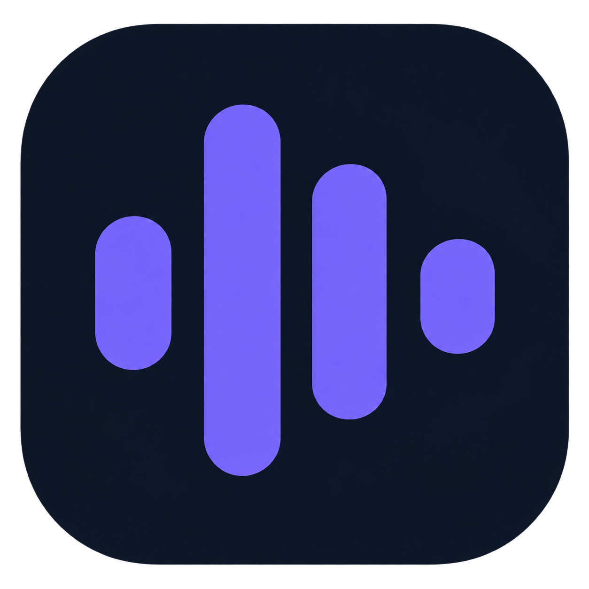

# Voice Notes



**Grave, transcreva e organize suas conversas em um só lugar.** O Voice Notes é um aplicativo para Windows que captura o microfone, o som do computador ou ambos. A transcrição é feita localmente com Whisper; se você quiser um resumo, pode conectar Codex, Claude Code ou uma API de IA.

[Baixar o instalador](https://github.com/VictorJurado18/voice-notes-releases/releases/latest) · [Como começar](#primeiros-passos) · [Resolver problemas](#se-algo-não-funcionar) · [Desenvolvimento](DEVELOPMENT.md)

## O que você pode fazer

| Recurso | O que faz |
|---|---|
| **Gravar** | Capture reuniões, aulas e chamadas usando microfone, áudio do sistema ou os dois. |
| **Transcrever** | Transforme áudio em texto no próprio computador, com aceleração por GPU NVIDIA compatível quando disponível. |
| **Resumir** | Gere resumos em formatos como reunião, aula, entrevista e plano de ação. |
| **Importar** | Processe arquivos de áudio, transcrições prontas e vídeos do YouTube que você tenha autorização para usar. |
| **Organizar** | Encontre gravações na Biblioteca, edite documentos e exporte em PDF ou DOCX. |

Funciona no **Windows 10 ou 11, 64 bits**. Para usar o instalador, você não precisa instalar Python nem abrir um terminal. O primeiro uso de um modelo Whisper precisa de internet para baixá-lo. Consulte as notas da versão publicada para conferir os recursos disponíveis no instalador.

## Primeiros passos

1. Baixe `VoiceNotes-Setup-x.y.z.exe` na [página de versões](https://github.com/VictorJurado18/voice-notes-releases/releases/latest) e execute o instalador. Escolha a instalação opcional de Codex CLI e Claude Code se quiser criar resumos com um deles.
2. Abra **Voice Notes** pelo menu Iniciar. Na página **Gravar**, escolha a **Fonte de áudio** e confira a pasta em **Salvar em**.
3. Em **Depois de parar**, escolha **Salvar só o áudio**, **Áudio + transcrição** ou **Áudio + transcrição + resumo**. Clique em **Iniciar gravação** e, quando terminar, em **Parar**.

O áudio é salvo antes de começar a transcrição ou o resumo. Se você escolher processar depois da gravação, acompanhe as etapas em **Processos**; pode ocultar a janela enquanto o trabalho continua. Uma gravação salva só como áudio pode ser processada mais tarde pela **Biblioteca**.

Por padrão, cada gravação ganha uma pasta dentro de `Música\record-transcript-resume`:

```text
recording-AAAAMMDD-HHMMSS/
├── recording-AAAAMMDD-HHMMSS.mp3
├── transcription.md  (se você transcrever)
└── summary.md        (se você resumir)
```

### Para criar resumos

Abra **Ajustes → Resumos e IA** e escolha como gerar o resumo:

- **Codex ou Claude Code:** use **Conectar conta no navegador** e siga o login do serviço escolhido.
- **API por token:** use **+ Novo Provider** e informe a URL, o modelo e a chave. A chave fica no Cofre de Credenciais do Windows.

A transcrição funciona sem configurar nenhum desses serviços. Ao pedir um resumo, o texto transcrito é enviado ao provider que você escolheu. Você pode testar Codex ou Claude Code em **Ajustes → Diagnóstico**; o teste pode consumir uso da sua conta.

### Para ajustar a transcrição

Em **Ajustes → Transcrição**, escolha o idioma e o modelo Whisper. `small` é uma escolha inicial equilibrada; `tiny` e `base` são mais leves, enquanto `medium` e `large-v3` exigem mais recursos. O modelo é baixado na primeira utilização. **Testar modelo** permite verificar se ele carrega e informa qual dispositivo foi usado.

Em uma GPU NVIDIA compatível, o app tenta acelerar a transcrição. Se a GPU não estiver disponível ou falhar, ele tenta novamente pela CPU. GPUs AMD e Intel usam a CPU nesta versão.

Para identificar **Pessoa 1**, **Pessoa 2** etc., aceite as condições do modelo [pyannote/speaker-diarization-community-1](https://huggingface.co/pyannote/speaker-diarization-community-1), crie um token de leitura no Hugging Face e salve-o em **Ajustes → Transcrição**. Depois, ative **Separar falantes** na gravação ou importação desejada. A opção permanece desligada por padrão, mesmo com o token salvo. A identificação não descobre automaticamente os nomes das pessoas; na Biblioteca, você pode revisar sugestões e aplicar nomes manualmente.

## Outros caminhos

| Se você já tem… | Abra | Faça isto |
|---|---|---|
| Um áudio | **Arquivo** | Importe e escolha transcrição, resumo ou ambos. |
| Um texto transcrito | **Arquivo** | Cole o texto ou abra um `.txt`/`.md` para gerar um resumo. |
| Um vídeo autorizado | **YouTube** | Cole o link e escolha o resultado desejado. |
| Uma gravação salva | **Biblioteca** | Abra o áudio, edite a transcrição ou o resumo, exporte ou processe depois. |

Na **Biblioteca**, você pode buscar, filtrar, favoritar e editar títulos e etiquetas. **Escolher pasta** mostra resultados de outro local sem mudar a pasta das próximas gravações. A importação preserva o arquivo original e cria uma cópia na pasta de resultados.

O botão **Minimizar** reduz o app a uma etiqueta na tela. **Ocultar** o deixa acessível pelo ícone perto do relógio do Windows, que também permite mostrar e encerrar o programa. Em **Ajustes → Atualizações**, você pode verificar e instalar novas versões quando forem publicadas.

## Se algo não funcionar

| Situação | O que conferir |
|---|---|
| **A janela sumiu** | Procure o ícone do Voice Notes perto do relógio, inclusive na seta `^` de itens ocultos, e dê dois cliques. |
| **Não houve resumo** | Confira o provider em **Ajustes → Resumos e IA** e a conexão em **Diagnóstico**. A transcrição continua salva se o resumo falhar. |
| **A transcrição falhou** | Abra **Processos → Ver erro**. Em **Ajustes → Transcrição**, use **Testar modelo**; o primeiro teste pode baixar arquivos. |
| **Falhou a separação de falantes (403)** | Confirme que aceitou as condições do modelo no Hugging Face e que o token tem permissão de leitura. |
| **O som do computador não apareceu** | Selecione **Sistema** ou **Microfone + sistema** e confira o dispositivo de saída padrão do Windows. |

Em **Ajustes → Diagnóstico**, você também pode verificar a pasta de saída, o microfone, o áudio do sistema e os serviços de IA. O log técnico fica em `%LOCALAPPDATA%\Voice Notes\recorder.log`; inclua-o ao [relatar um problema](https://github.com/VictorJurado18/gavador_audio/issues), sem anexar conteúdo confidencial desnecessário.

## Privacidade

O áudio é gravado e transcrito no seu computador. A separação opcional de falantes também é feita localmente após baixar o modelo. Para gerar resumos, o app envia o **texto** ao serviço de IA selecionado; confira as regras desse serviço antes de processar material sensível. Ao usar a página YouTube, o app acessa o link informado para baixar o áudio. Os arquivos produzidos ficam na pasta que você escolheu.

## Para quem desenvolve

O código-fonte, a configuração local, a CLI, os testes e o processo de build estão em [DEVELOPMENT.md](DEVELOPMENT.md). O [histórico de versões](https://github.com/VictorJurado18/voice-notes-releases/releases) contém os instaladores publicados.
